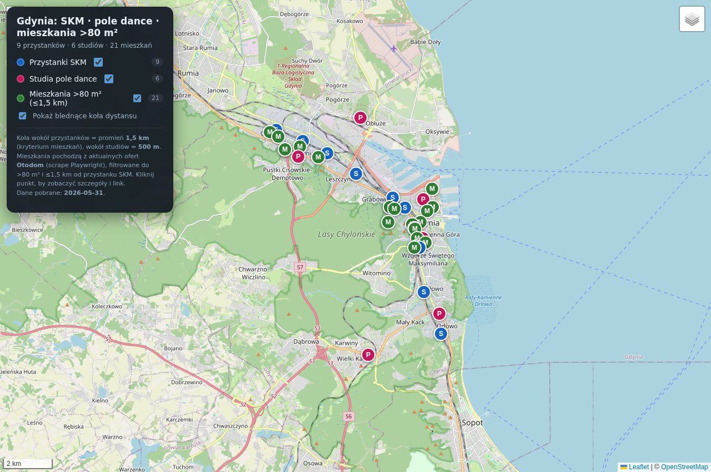

# Gdynia — SKM, pole dance i mieszkania >80 m²

Interaktywna mapa Gdyni (Leaflet + OpenStreetMap) z trzema przełączanymi warstwami:

1. **Przystanki SKM** — 9 przystanków Szybkiej Kolei Miejskiej w granicach Gdyni.
   Wokół każdego blednące ku krawędzi koło o promieniu **1,5 km** (kryterium wyszukiwania mieszkań).
2. **Studia pole dance** — z linkami do stron studiów; wokół każdego blednące koło **500 m**.
3. **Mieszkania > 80 m²** — aktualne oferty sprzedaży z Otodom, **nie dalej niż 1,5 km** od
   przystanku SKM. Każdy punkt ma link do oferty, cenę, metraż i odległość do najbliższego SKM.

> Pierwotnie proszono o mapę Google. Google Maps JavaScript API wymaga klucza, którego nie ma
> w środowisku, więc — za zgodą — użyto **Leaflet + OpenStreetMap** (działa bez klucza, od razu).
> Logika warstw, kół dystansu i danych jest niezależna od dostawcy map.

## Uruchomienie

Otwórz `index.html` w przeglądarce (działa z `file://`, dane ładują się z `data/data.js`).
Leaflet ładowany jest z CDN, więc potrzebny jest dostęp do internetu przy pierwszym otwarciu.

## Dane

Wynikowe dane są w `data/data.json` (oraz `data/data.js` — ta sama treść jako `window.MAP_DATA`,
żeby strona działała bez serwera). Pole `generatedAt` zawiera datę pobrania.

### Skąd pochodzą

| Warstwa | Źródło | Metoda |
|---|---|---|
| Przystanki SKM | OpenStreetMap (Overpass API) | `scrape/skm.py` |
| Studia pole dance | wyszukiwanie web + geokodowanie Nominatim | `scrape/studios.py` |
| Mieszkania >80 m² | Otodom (`__NEXT_DATA__`) | `scrape/otodom.js` + `scrape/otodom_detail.js` (Playwright) |

Współrzędne mieszkań pochodzą ze stron szczegółowych ofert Otodom; dla pojedynczych braków
stosowany jest geokoder Nominatim (po ulicy/dzielnicy). Filtr metrażu (≥80 m²) i odległości
(≤1,5 km od SKM) liczony jest w `scrape/build.py` (haversine).

## Ponowne pobranie danych

```bash
npm install                      # playwright (node)
npx playwright install chromium
python3 scrape/skm.py            # przystanki SKM
python3 scrape/studios.py        # studia pole dance
node    scrape/otodom.js         # lista ofert Otodom
node    scrape/otodom_detail.js  # współrzędne ofert >80 m²
node    scrape/otodom_retry.js   # ponów braki współrzędnych
python3 scrape/build.py          # filtr + data/data.js + data/data.json
```

## Podgląd



Oferty mieszkań są dynamiczne — liczba i ich lokalizacje zmieniają się przy każdym pobraniu.
